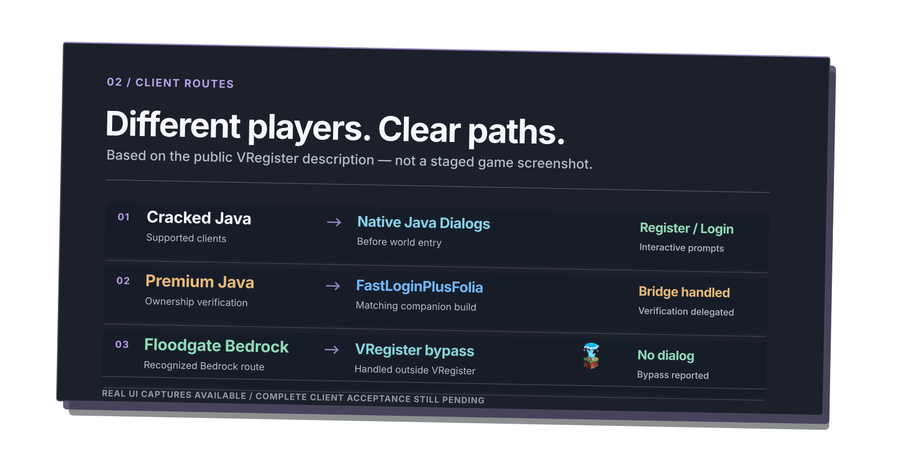
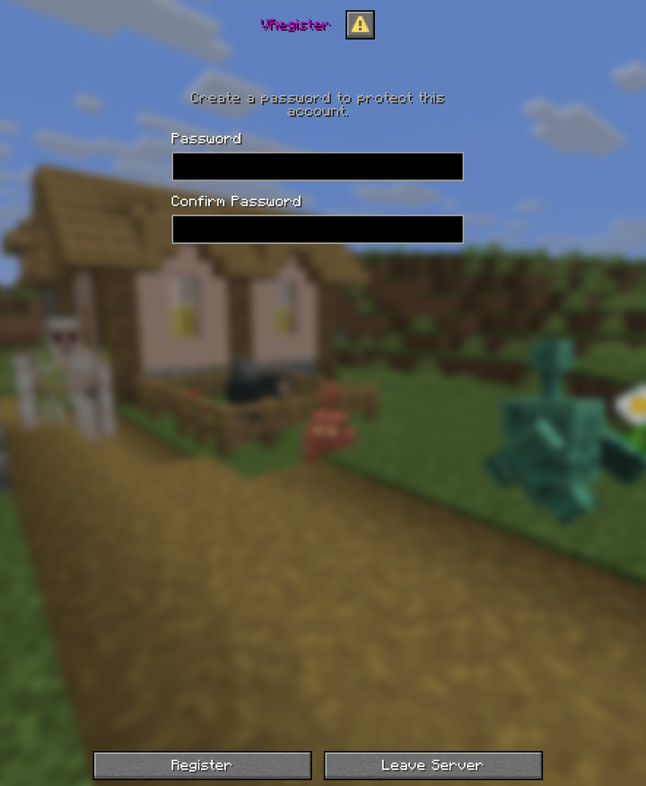
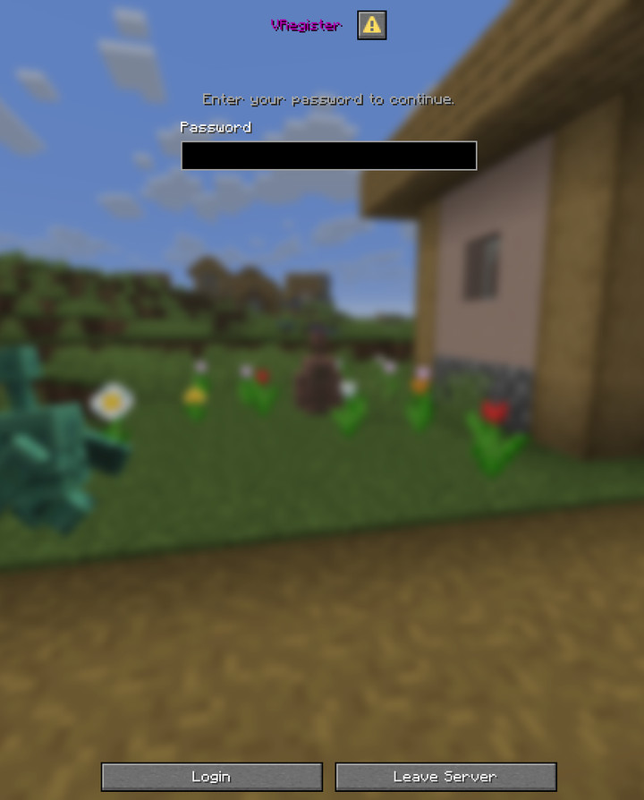

  

# VRegister

**Account registration and login management for [Folia 1.21.11](https://github.com/PaperMC/Folia).** VRegister is commercial software by **VACK STUDIO**. According to the project's published description, it manages account registration, BCrypt password hashes, SQLite accounts and login sessions. Supported cracked Java clients receive native Java Dialogs before world entry.

> [!IMPORTANT]
> **Commercial / proprietary release.** This repository is a public presentation and product-information page. It does **not** contain VRegister's installable JAR or source code. Distribution and usage require separate written authorization from VACK STUDIO.

## Access routes

  

VRegister presents native registration/login dialogs to **supported cracked Java players**. Premium ownership verification is delegated to a private patched build based on [FastLoginPlusFolia](https://github.com/Hayston1001/FastLoginPlus). [Floodgate](https://github.com/GeyserMC/Floodgate) users connecting through [Geyser](https://github.com/GeyserMC/Geyser) follow the documented Bedrock bypass route.

**Related projects:** [FastLoginPlusFolia](https://github.com/Hayston1001/FastLoginPlus) · [Floodgate](https://github.com/GeyserMC/Floodgate) · [GeyserMC](https://github.com/GeyserMC/Geyser) · [ProtocolLib](https://github.com/dmulloy2/ProtocolLib) · [Folia](https://github.com/PaperMC/Folia). These GitHub links open upstream projects, **not VACK Studio's private patched bridge**.

  
  &nbsp;&nbsp;&nbsp;
  

## Real Minecraft screenshots

Actual Minecraft Java client screenshots provided by the project owner on **18 November 2026**. The two dialogs are resized for GitHub display; their original captures are preserved separately. These are **not AI-generated or simulated interfaces**.

<table>
  <tr>
    <td width="50%" align="center">
      <strong>01 / Register Dialog</strong>
      
    </td>
    <td width="50%" align="center">
      <strong>02 / Login Dialog</strong>
      
    </td>
  </tr>
</table>

**03 / Automatic login chat message**

  

The automatic-login message is visual evidence of the client output; by itself it does **not independently prove Premium identity verification** or full authentication acceptance.

## Accounts and sessions

  

The public repository describes these functions, but does not disclose internal schemas, implementation details or customer credentials.

## Compatibility and verification

  

| Item | Reported requirement or status |
| --- | --- |
| VRegister | **2.2.0**, artifact metadata and SHA-256 verified in the maintainer's recovery report |
| Server | [Folia **1.21.11**](https://github.com/PaperMC/Folia) |
| Java | **21 build target**; reported Java 25 project runtime |
| Premium bridge | Private patched [FastLoginPlusFolia](https://github.com/Hayston1001/FastLoginPlus) build, `0.7.0-vregister.1-2c5808e` |
| Bridge dependency | [ProtocolLib](https://github.com/dmulloy2/ProtocolLib) **5.4.0** in staging |
| Optional integrations | [Floodgate](https://github.com/GeyserMC/Floodgate) and [ViaVersion](https://github.com/ViaVersion/ViaVersion) |
| Unit tests | **6 VRegister tests passed**; **163 upstream tests and 5 bridge tests passed**, with 2 upstream skipped (reported by maintainer) |
| Real UI captures | Register, Login and automatic-login message shown above |
| Complete client security acceptance | **Not yet independently verified** across Premium, cracked, legacy and Bedrock clients |

<strong>Screenshot provenance and test limitations</strong>

Owner-supplied Minecraft Java screenshots are displayed above. The original images remain outside this public repository; the README includes quality-compressed dialog screenshots and a cropped, original chat snippet. The screenshots show the UI and message, but they do not independently verify every authentication security path or optional Bedrock support.

The VRegister 2.2.0 and patched FastLoginPlusFolia build/test results were reported by the maintainer. No production database or password was provided or published.

## Availability

VRegister is **paid software**. Source access and installable builds are distributed privately to VACK STUDIO-approved accounts. To request access or discuss commercial terms, use the official VACK channels below. This repository does not grant redistribution or publication rights.

---

  

  
  &nbsp;&nbsp;&nbsp;&nbsp;
  

<strong>License &amp; rights — VACK STUDIO</strong>

Copyright © 2026 VACK STUDIO. All rights reserved.

VRegister and its original documentation and artwork are proprietary. No permission to copy, modify, distribute, sublicense, resell or publish is granted without prior written authorization. Third-party components retain their own licenses.

Read the authoritative [LICENSE](LICENSE) for the complete legal notice.

Presentation artwork: source-backed, non-generative SVG with owner-supplied Java client captures. No login interface or gameplay image has been invented. <a href="docs/DESIGN-AUDIT.md">Design provenance and QA notes</a>.
