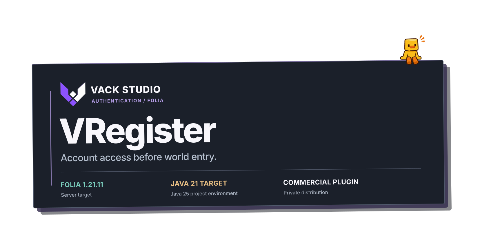
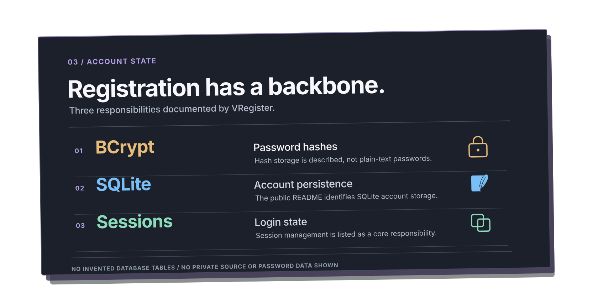
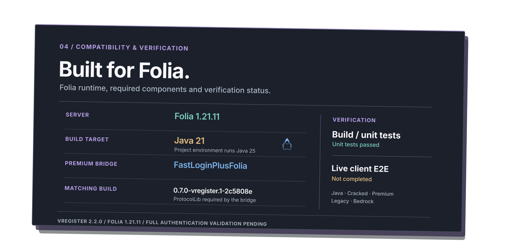
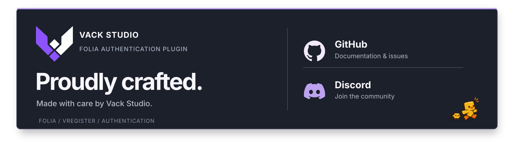

  

# VRegister 

**Account registration and login for [Folia 1.21.11](https://github.com/PaperMC/Folia).** VRegister gives supported Java players native Minecraft Register and Login Dialogs, BCrypt password hashing, SQLite account storage and managed login sessions.

> [!IMPORTANT]
> **Commercial plugin.** VRegister is proprietary software by **VACK STUDIO**. This public repository contains product information only; the source and installable JAR are distributed privately under written authorization.

## How authentication works

**Which sign-in flow will a player see?** 

  

<table>
  <tr>
    <td align="center" width="54"></td>
    <td><strong>Java Edition</strong> — supported offline-mode players use VRegister's registration/login Dialogs. Premium verification is handled by the required <a href="https://github.com/Hayston1001/FastLoginPlus">FastLoginPlusFolia</a> bridge.</td>
  </tr>
  <tr>
    <td align="center"></td>
    <td><strong>Bedrock Edition</strong> — players connected through <a href="https://github.com/GeyserMC/Geyser">Geyser</a> and recognized using the official <a href="https://github.com/GeyserMC/Floodgate">Floodgate</a> API bypass VRegister's Java authentication screens.</td>
  </tr>
</table>

## In-game dialogs

<table>
  <tr>
    <td width="50%" align="center">
      <strong>Register Dialog</strong>
      
    </td>
    <td width="50%" align="center">
      <strong>Login Dialog</strong>
      
    </td>
  </tr>
</table>

**Automatic login confirmation**

  

## Accounts and sessions

  

VRegister uses **BCrypt** for password hashes and **SQLite** to store accounts, with sessions controlling authenticated access.

## Compatibility

  

| Component | Version or requirement |
| --- | --- |
| VRegister | **2.2.0** |
| Server | [Folia 1.21.11](https://github.com/PaperMC/Folia) |
| Java | Build target **Java 21**; staging environment reported using Java 25 |
| Required Premium bridge | VRegister-specific patched [FastLoginPlusFolia](https://github.com/Hayston1001/FastLoginPlus), `0.7.0-vregister.1-2c5808e` (plugin name: `FastLoginPlus`) |
| Bridge dependency | [ProtocolLib](https://github.com/dmulloy2/ProtocolLib); **5.4.0** used in staging |
| Optional integrations | [Floodgate](https://github.com/GeyserMC/Floodgate) and [ViaVersion](https://github.com/ViaVersion/ViaVersion) |

### Notes

The VRegister-specific FastLoginPlusFolia bridge includes configuration-phase authentication support missing from stock 0.7.0 builds. Install the matching bridge and verify the dependencies before allowing players to connect. 

### Verification status

The VRegister 2.2.0 build and **6 unit tests** passed in the reported staging build. The patched FastLoginPlusFolia build passed **163 upstream tests and 5 bridge tests**, with 2 upstream tests skipped.

The Register and Login Dialogs and automatic-login message have been observed in a Java client. Full authentication acceptance, including Premium verification, legacy clients and optional Floodgate/Bedrock support, is still pending.

## Availability

VRegister is **commercial software**. Installable builds and source access are provided privately to VACK STUDIO-approved customers. For access and license terms, use the official links below.

---

  

  
  &nbsp;&nbsp;&nbsp;&nbsp;
  

<strong>License &amp; rights — VACK STUDIO</strong>

 
Copyright © 2026 VACK STUDIO. All rights reserved.

The plugin, documentation and original artwork are proprietary. Redistribution, modification or publication requires prior written authorization. See the full [LICENSE](LICENSE).

